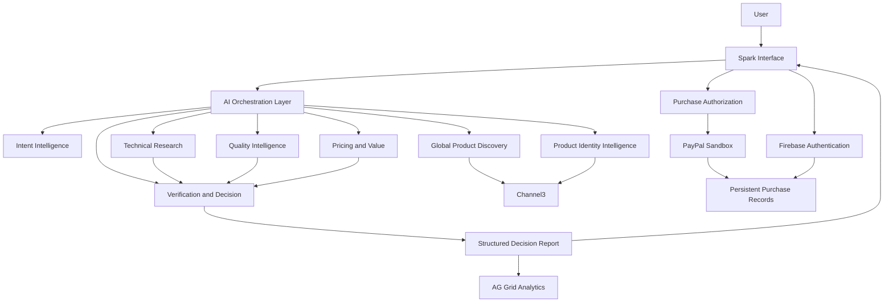
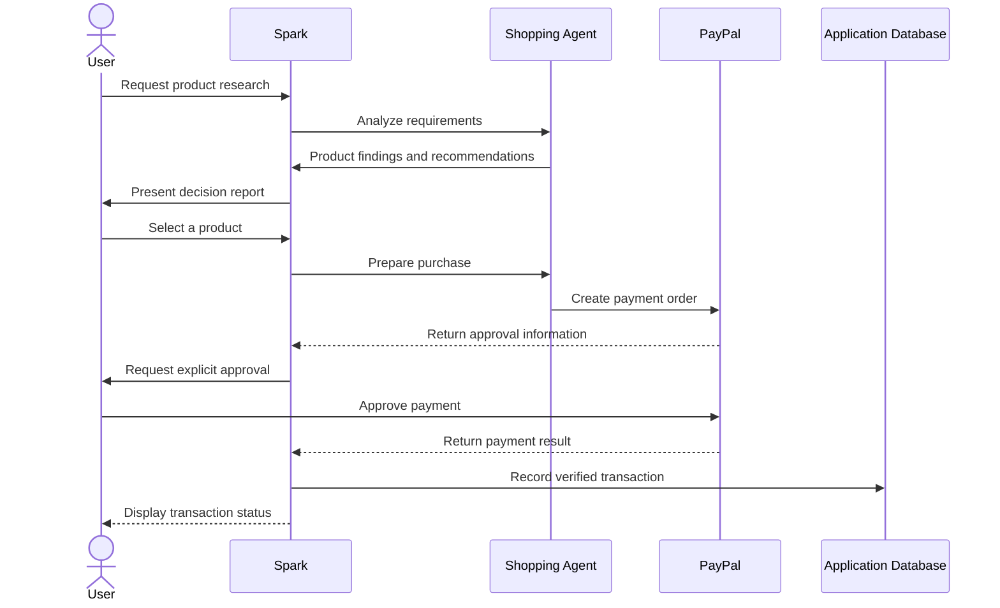

# ⚡ Spark — Global Product Intelligence

<p align="center">
  <strong>Discover Smarter. Decide with Confidence. Shop Globally.</strong>
</p>

<p align="center">
  An AI-powered global shopping intelligence platform that transforms product discovery, research, comparison, and purchasing into one intelligent experience.
</p>

---

## 🌍 Overview

**Spark** is an AI-powered product intelligence and shopping platform designed to help people make better purchasing decisions.

Instead of simply searching for products or generating generic recommendations, Spark coordinates specialized AI agents to research products, analyze technical specifications, evaluate value, examine available evidence, and generate structured purchasing recommendations.

Spark bridges the gap between AI-powered research and real-world commerce by connecting product intelligence with payment infrastructure.

Our mission is simple:

**Make global shopping more intelligent, transparent, and accessible.**

## ✨ Key Features

### 🧠 Multi-Agent Intelligence

Spark uses a coordinated multi-agent architecture in which specialized agents collaborate to solve different parts of the product research process.

The architecture includes seven core specialist roles:

1. **Intent & Requirements Intelligence** — Understands user requests, budgets, preferences, and constraints.
2. **Global Product Discovery** — Discovers relevant products using product intelligence sources.
3. **Product Identity & Catalog Intelligence** — Identifies products and analyzes catalog information.
4. **Technical Product Research** — Examines specifications, features, and technical capabilities.
5. **Quality & Reputation Intelligence** — Evaluates available quality indicators and reputation evidence.
6. **Pricing & Value Intelligence** — Analyzes pricing, offers, and overall commercial value.
7. **Independent Verification & Decision Intelligence** — Examines supporting evidence and produces the final recommendation.

An orchestration layer coordinates the research workflow and manages information exchange between agents.

### 🔎 Global Product Discovery

Powered by Channel3 product intelligence, Spark is designed to help users:

- Discover relevant products.
- Retrieve structured product information.
- Identify product alternatives.
- Compare available product data.
- Evaluate commercial opportunities.

### 📊 Advanced Product Evaluation

Spark evaluates products across multiple dimensions rather than relying on a single rating.

Its research framework considers:

- Technical specifications.
- Performance and capabilities.
- Quality and reputation.
- Pricing and value.
- Advantages and disadvantages.
- User requirements and constraints.
- Available supporting evidence.

### 📑 Structured Decision Reports

Spark transforms research into structured reports containing:

1. Overview
2. Technical Specifications
3. Performance Analysis
4. Advantages
5. Disadvantages
6. Price & Value
7. Evaluation
8. Product Comparison
9. Final Verdict
10. Sources & Evidence

The goal is to make complex purchasing decisions understandable, transparent, and actionable.

### 💳 PayPal-Powered Purchasing

Spark integrates PayPal payment infrastructure to connect product discovery with purchasing workflows.

The intended purchasing lifecycle includes:

1. Product selection.
2. Purchase preparation.
3. PayPal order creation.
4. User review and approval.
5. Payment execution.
6. Transaction confirmation.
7. Purchase record management.

PayPal Sandbox is used for development and payment-flow testing.

**User authorization is required before a purchase is executed.**

### 🔐 User Infrastructure

Firebase provides the foundation for:

- User authentication.
- Account management.
- Persistent application data.
- User-specific information.
- Data access controls.

### 📈 Analytics & Data Visualization

AG Grid supports advanced data presentation and analytical interfaces, enabling structured product comparisons and information-rich dashboards.

---

## 🏗️ Technology Stack

| Technology | Purpose |
|---|---|
| Claude | AI reasoning and agent orchestration |
| Channel3 | Product discovery and product intelligence |
| PayPal | Payment and purchasing infrastructure |
| APIMatic | API integration assistance |
| Firebase | Authentication and persistent data |
| AG Grid | Data visualization and analytics |
| Gemini | AI development and supporting model workflows |

### Technology Integration Philosophy

Each technology serves a specific purpose within Spark.

Rather than connecting services without a clear architectural role, Spark organizes them around three major capabilities:

- **Intelligence:** Research, reasoning, evaluation, and decision-making.
- **Infrastructure:** Authentication, data management, and API connectivity.
- **Commerce:** Product selection, payment approval, and transaction management.

---

## 🧩 System Architecture

The following diagram illustrates Spark's logical architecture.



---

## 🛒 Purchasing Workflow

Spark is designed around a user-controlled purchasing process.



*This sequence describes the intended purchasing lifecycle. Actual transaction states must always be verified against PayPal responses.*

---

## 🔒 Security & Reliability

Spark is designed with security and transaction integrity as core requirements.

Key engineering principles include:

- Secure handling of API credentials.
- Server-side payment operations.
- No exposure of private credentials in client-side code.
- Explicit user authorization before purchasing.
- Validation of payment environment configuration.
- PayPal Sandbox isolation during development.
- Authentication and controlled access to user data.
- Verification of transaction status before reporting successful payment.
- Graceful handling of API failures and missing credentials.
- Evidence-based recommendations that distinguish unavailable information from verified facts.

**Important:** Spark's development and testing environment uses PayPal Sandbox. No production payment capability should be assumed unless separately configured and verified.

---

## 🧪 Testing & Quality Assurance

Spark requires testing at multiple levels to ensure reliability.

### AI Agent Testing

- Agent responsibility validation.
- Multi-agent communication.
- Context preservation.
- Product identification accuracy.
- Research completeness.
- Recommendation consistency.
- Source and evidence validation.

### API Integration Testing

- Authentication.
- Credential validation.
- API response handling.
- Error handling.
- External service availability.

### PayPal Testing

- Sandbox authentication.
- Order creation.
- Approval workflow.
- Payment execution.
- Payment status verification.
- Invalid credential handling.
- Unauthorized transaction prevention.

### Application Testing

- User authentication.
- Account isolation.
- Data persistence.
- Dashboard functionality.
- End-to-end purchasing workflows.

---

## 🚀 Getting Started

The exact installation and execution commands depend on the project's current repository structure.

### Prerequisites

- Node.js (if using the Node.js application environment).
- Access to the configured AI model provider.
- Channel3 API credentials.
- PayPal Sandbox developer credentials.
- Firebase project credentials.
- Required environment variables.

### Installation

Clone the repository:

```bash
git clone YOUR_REPOSITORY_URL
cd YOUR_PROJECT_DIRECTORY
```

Install dependencies using the package manager specified by the project:

```bash
npm install
```

Configure the environment variables required by your deployment.

### Environment Configuration

Create a local `.env` file based on your project's environment configuration.

Example variable categories:

```env
# AI Provider
AI_PROVIDER_API_KEY=

# Channel3
CHANNEL3_API_KEY=

# PayPal Sandbox
PAYPAL_CLIENT_ID=
PAYPAL_CLIENT_SECRET=
PAYPAL_ENV=sandbox

# Firebase
FIREBASE_PROJECT_ID=
FIREBASE_CLIENT_EMAIL=
FIREBASE_PRIVATE_KEY=
```

Additional variables may be required depending on the application architecture.

**Never commit `.env` files, private keys, payment credentials, or other secrets to version control.**

### Running the Application

Use the scripts defined in the repository's `package.json` or the corresponding application configuration.

For example:

```bash
npm run dev
```

---

## 🏆 Built for PayPal AI Hackathon

Spark explores how AI agents and payment infrastructure can work together to create a more intelligent commerce experience.

The project brings together:

- AI-powered research and decision-making.
- Multi-agent collaboration.
- Channel3 product intelligence.
- PayPal payment infrastructure.
- Structured analytics and data visualization.
- User-controlled purchasing workflows.

Our goal is to demonstrate that AI can become more than a conversational shopping assistant: it can become an intelligent decision-making layer connecting product research with commerce.

---

## 🗺️ Roadmap

Our long-term development priorities include:

- [ ] Expand global product coverage.
- [ ] Improve product identity matching and catalog accuracy.
- [ ] Strengthen independent verification.
- [ ] Improve multi-agent coordination and execution efficiency.
- [ ] Expand product comparison capabilities.
- [ ] Enhance personalized recommendations.
- [ ] Strengthen Firebase authentication and data security.
- [ ] Complete and validate end-to-end purchasing workflows.
- [ ] Expand supported markets and currencies.
- [ ] Improve analytics and decision reporting.

---

## 🤝 Contributing

Spark is an evolving project focused on AI-powered commerce and intelligent product research.

Contributions and ideas that improve reliability, product intelligence, agent architecture, security, and user experience are welcome.

Before proposing major changes, review the existing architecture and preserve established integrations.

---

## 📜 License

Specify the project's actual license before distributing or accepting external contributions.

---

## ⚡ Final Vision

We believe the future of commerce is not about giving users more products to search through.

It is about helping them make better decisions.

Spark aims to bring product intelligence, AI reasoning, independent evaluation, and secure purchasing together in one unified experience.

**Spark — Discover Smarter. Decide with Confidence. Shop Globally.**
